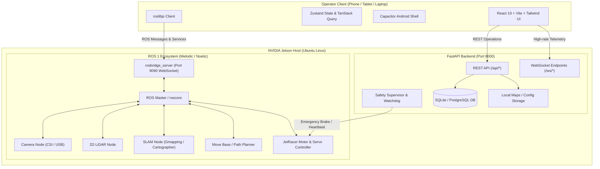

# JetRacer Control Center — Architecture Specification

> **STATUS:** Phase 0 Architecture Blueprint. All hardware integrations, telemetry streams, ROS communications, and security policies are planned and NOT yet hardware-tested or inspected on the physical robot.

---

## 1. System Overview

JetRacer Control Center is an integrated robotics management interface designed to eliminate the need for direct SSH sessions or HDMI display cables when operating the Waveshare / NVIDIA JetRacer ROS AI Kit. It provides a multi-platform operator interface (responsive web app, installable Android APK via Capacitor, and desktop browser client) communicating over the local Wi-Fi network with an on-robot FastAPI backend and a ROS 1 ecosystem (`rosbridge_suite`).

---

## 2. Planned Modular Subsystems

| Subsystem | Planned Backend Folder | Planned Implementation Phase | Primary Responsibility |
| :--- | :--- | :--- | :--- |
| **Robot Connection** | `app/api/`, `app/core/` | Phase 3 | Dynamic IP discovery, target reachability ping, persistent host settings, and connection heartbeat. |
| **ROS Integration** | `app/ros/` | Phase 4 | ROS topic inspection, service proxying, parameter retrieval, and rosbridge WebSocket session lifecycle. |
| **Camera Streaming** | `app/services/` | Phase 5 | WebRTC/MJPEG camera proxying, frame rate scaling, resolution adjustments, and latency optimization. |
| **LiDAR Visualization** | `app/services/`, `app/ros/` | Phase 6 | 2D laser scan parsing, point cloud downsampling, obstacle proximity alerts, and polar coordinate rendering. |
| **Mapping & SLAM** | `app/services/` | Phase 7 | SLAM launch orchestration, occupancy grid map tile streaming, map saving (`.yaml` / `.pgm`), and map listing. |
| **Manual Control** | `app/safety/`, `app/ros/` | Phase 8 | Virtual joystick control, keyboard bindings, steering trim calibration, and acceleration profiling. |
| **Autonomous Navigation** | `app/services/`, `app/ros/` | Phase 9 | Waypoint sequence delivery, 2D goal pose dispatch, localization verification, and path obstacle replanning. |
| **System Management** | `app/services/` | Phase 10 | Jetson hardware health (CPU, GPU, RAM, disk, thermal zones, Tegrastats/jtop), and systemd service controls. |
| **Database & History** | `app/database/`, `app/models/` | Phase 11 | SQLite persistence for navigation logs, telemetry events, saved configurations, and map catalogue metadata. |
| **Safety Supervisor** | `app/safety/` | Phase 8 & Phase 13 | Hardware/software watchdog, packet loss dead-man switch, speed limiting, and unconditional Emergency Stop (E-Stop). |

---

## 3. Communication Protocols and Data Flow

1. **Standard Operations (REST API):**
   - Transports CRUD operations, system configurations, map management, historical queries, and service triggers over HTTP/1.1 (`/api/*`).
   - Clean separation of concerns with standard HTTP response codes and typed JSON payloads.

2. **Real-time Subsystem Telemetry (WebSockets):**
   - Direct duplex WebSockets (`/ws/*`) for high-frequency internal telemetry (e.g. CPU/GPU thermals, motor feedback) without polling overhead.

3. **Robotics Protocol (`rosbridge_suite`):**
   - The browser and Capacitor client connect directly or via backend proxy to `rosbridge_server` (standard port `9090`) using `roslibjs`.
   - Used for streaming ROS standard topics (`sensor_msgs/LaserScan`, `geometry_msgs/Twist`, `nav_msgs/OccupancyGrid`, `nav_msgs/Odometry`).
   - Rosbridge protocol specifications and actual topic mappings remain marked as **NOT YET INSPECTED** until Phase 4.

---

## 4. Storage Architecture

- **Primary Database:** Local SQLite database (`sqlite:///./data/jetracer.db`) stored on the Jetson flash storage. SQLite provides zero-configuration, zero-dependency embedded transactions ideal for single-robot deployments.
- **Relational Schema Readiness:** Built on top of SQLAlchemy 2.0 ORM. All database access uses declarative models and session factories. If scaling to a multi-robot fleet or central telemetry server in the future, transitioning to PostgreSQL requires modifying only the `DATABASE_URL` environment configuration.
- **Large Binary Files (Maps & Logs):** 2D SLAM maps (`.yaml` metadata and `.pgm` bitmap files) are stored directly on the Jetson filesystem under a dedicated storage directory, with file metadata, timestamps, and thumbnails catalogued in SQLite.

---

## 5. Network, Safety, and Security Principles

### Network Design (Local-First)
- **Zero Cloud Dependency:** JetRacer Control Center operates exclusively over the local area network (LAN / Wi-Fi). No external internet connectivity, paid APIs, or telemetry beacons are utilized.
- **Android Cleartext Policy:** Android 9+ enforces HTTPS by default. In Phase 0-12 development, `cleartext: true` in `capacitor.config.ts` and `android:usesCleartextTraffic="true"` in the Android manifest allow local LAN communication with `http://<JETSON_IP>:8000` and `ws://<JETSON_IP>:9090`. Complete TLS hardening (WSS/HTTPS) is scheduled for Phase 13.

### Safety Design (Required for Physical Robot Testing)
- **Watchdog / Dead-Man Switch:** Velocity commands (`geometry_msgs/Twist`) must have an active heartbeat (e.g. every 100-200ms). If communication drops for more than 500ms, the robot controller automatically zeros the velocity vector and applies braking.
- **Hardware Emergency Stop:** The UI will feature a prominent, sticky E-Stop button that immediately dispatches stop frames and cuts motor enable lines. Regardless of software state, the operator must always maintain physical access to the JetRacer's hardware battery power switch.
- **Software Speed Clamping:** The backend enforces maximum linear and angular speed caps regardless of raw user input, preventing accidental high-speed collisions in confined spaces.

---

## 6. Python Version Compatibility Note (Jetson vs Development Host)

- **Development Environment:** Windows host running modern Python 3.14.
- **Jetson Runtime Environment:** NVIDIA Jetson devices running JetPack 4.x / 5.x with Ubuntu 18.04 (ROS 1 Melodic) or Ubuntu 20.04 (ROS 1 Noetic) typically run **Python 3.6, Python 3.8, or Python 3.10**.
- **Compatibility Guideline:**
  - Backend source code must adhere strictly to Python 3.8+ compatible syntax (e.g., using `typing.List`, `typing.Optional`, `typing.Dict`, avoiding `match/case` statements and union operators `|` in type annotations).
  - All dependency versions specified in `backend/requirements.txt` will be validated against the Jetson's specific Python runtime during Phase 15 deployment. If the Jetson runs Python 3.8, compatible wheels for FastAPI, Pydantic, and SQLAlchemy are available.

---

## 7. Real vs Simulated Data Policy

- **Zero Mock / Fake Telemetry in Production:** No fake velocity values, synthesized camera streams, or simulated LiDAR ranges may be emitted by production backend services or UI pages.
- **Explicit Labelling:** Any testing stubs or simulation adapters developed in Phase 14 must be isolated under separate test harnesses or clearly stamped with a visual "SIMULATED DATA" badge in the UI. In Phase 0, all pages remain pure placeholders stating the phase of intended implementation.
