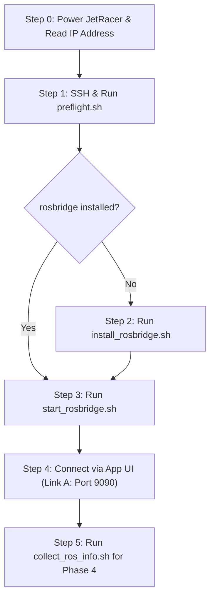

# JetRacer First Live Connection Runbook (Field Testing)

> **PURPOSE:** Step-by-step field procedures for connecting **JetRacer Control Center** to the physical NVIDIA JetRacer robot over local Wi-Fi.
>
> ⚠️ **SAFETY FIRST:**
> - Software E-Stop is **NOT** wired in Phase 3. It will **NOT** stop the physical robot.
> - Always maintain physical reach to the robot chassis **battery power switch**.
> - Keep the 2.4GHz wireless gamepad powered on with finger ready on the **R1 emergency brake trigger**.

---

## 0. Field Kit Checklist (What to Bring to the Lab)

Before heading to the lab/college, ensure you have:
1. **Development Laptop** with:
   - Wi-Fi capability.
   - This repository cloned and built (`npm run build` verified).
   - Python 3.10+ virtual environment ready in `backend/`.
2. **Personal Mobile Hotspot (Crucial Backup):**
   - College campus Wi-Fi networks often enforce **Client Isolation** (AP isolation), preventing direct peer-to-peer TCP/UDP packets between your laptop/phone and the robot.
   - If client isolation is active, switch both your laptop and the robot's Wi-Fi to your personal smartphone hotspot.
3. **USB Flash Drive (FAT32/ext4):**
   - Pre-loaded with the `robot/` folder containing all helper scripts.
4. **USB Micro-B / USB-C Cable & HDMI Cable (Emergency Display Fallback):**
   - In case the robot's IP address cannot be found or OLED is dark.
5. **2.4GHz Wireless Gamepad (TGZ) & Fresh Batteries:**
   - For physical hardware override and R1 emergency stop.

---

## 1. Step-by-Step Connection Procedure



---

### Step 0: Find Robot IP Address

1. Power on the JetRacer battery switch.
2. Allow ~45 seconds for Ubuntu 18.04 and ROS Melodic to boot.
3. **Direct HDMI & Keyboard Fallback (Most Reliable First Time):**
   - Connect an HDMI monitor and USB keyboard directly to the Jetson Nano.
   - Log in with `<robot-username>` and run:
     ```bash
     hostname -I
     ```
     The first IPv4 address listed is your robot's local IP address.
4. **Personal Mobile Hotspot Client List (Recommended at College):**
   - College campus Wi-Fi networks typically enforce **AP Client Isolation** or require captive portal login, blocking direct peer-to-peer traffic.
   - Connect both your development laptop and the Jetson to your personal smartphone mobile hotspot.
   - Open your phone's "Hotspot / Tethering" settings and check the "Connected devices" list to immediately view the assigned robot IP.
5. **OLED Display Method — [UNVERIFIED CLAIM]:**
   - *Note: OLED IP display availability is unverified until tested on the physical robot.* If your robot has the Waveshare OLED service active and properly configured, read the IP address shown on the small chassis OLED screen. Do not rely exclusively on this method.
6. **CLI Discovery from your laptop (if on same subnet without client isolation):**
   ```bash
   # Scan local subnet (example for 192.168.1.0/24)
   nmap -sn 192.168.1.0/24
   # Or ping local mDNS name (if avahi-daemon is running on robot):
   ping <robot-hostname>.local
   ```

---

### Step 1: Copy Helper Scripts & Run Preflight Audit

From your laptop terminal:
```bash
# Copy helper scripts to Jetson home directory
scp -r robot <robot-username>@<robot-ip>:~/jetracer-robot

# SSH into Jetson
ssh <robot-username>@<robot-ip>
```

On the Jetson shell:
```bash
cd ~/jetracer-robot/scripts
chmod +x *.sh

# Execute 100% read-only preflight audit
./preflight.sh
```

**Check the Preflight Summary:**
- `ROS Distro`: Expected `melodic`.
- `Roscore Active`: Should say `YES` (if JetRacer startup service has already run). If `NO`, see Troubleshooting.
- `Rosbridge Installed`: Note whether it reports `YES` or `NO`.

---

### Step 2: Install Rosbridge (Only if Missing)

If `preflight.sh` reported `Rosbridge Installed: NO`:
```bash
./install_rosbridge.sh
```
- The script detects ROS Melodic/Noetic.
- When prompted: `Type 'INSTALL' in capital letters to proceed with installation:`
- Type `INSTALL` and press Enter.
- It runs `sudo apt-get install -y ros-$ROS_DISTRO-rosbridge-suite`.

---

### Step 3: Start Rosbridge Server

Ensure the robot's vendor launch stack is running (e.g. `run_jetracer.sh`), then start the bridge:
```bash
./start_rosbridge.sh
```
You should see:
```text
==========================================================
    JetRacer Control Center - Starting Rosbridge Server
==========================================================
ROS Distribution: melodic
ROS Master is running and accessible.
Checking if port 9090 is already in use...
Starting rosbridge on port 9090 (0.0.0.0)...
[INFO] [...] [rosbridge_websocket]: Rosbridge WebSocket server started on port 9090
```
> Keep this terminal open while testing!

---

### Step 4: Connect via JetRacer Control Center

On your laptop or phone:
1. Open Google Chrome / Edge and navigate to the app (e.g. `http://localhost:5173` or your production build).
2. Go to **Settings -> Connection**.
3. In **Robot Address (IPv4 or Hostname)**, enter `<robot-ip>` (e.g. `192.168.1.105`).
4. Click **Connect**.
5. Within 1-2 seconds, observe:
   - Link A (Rosbridge WebSocket): **CONNECTED** (latency ~5-25 ms).
   - ROS Clock: Live timestamp updates from `/rosapi/get_time`.
   - Top Header Connection Pill turns **Green** ("Connected").
   - Link B (FastAPI Backend): **UNREACHABLE** (Expected and normal — backend is not installed on Jetson in Phase 3).

---

### Step 5: Collect ROS Metadata for Phase 4

In a second SSH terminal on the Jetson:
```bash
cd ~/jetracer-robot/scripts
./collect_ros_info.sh
```
- It inspects all active nodes, topics, publish rates (Hz), services, parameters, and TF frames with strict 3-second timeouts.
- Output is saved to `~/jetracer_inspection_<timestamp>.txt`.
- Copy this back to your development laptop:
  ```bash
  # Run from your laptop:
  scp <robot-username>@<robot-ip>:~/jetracer_inspection_*.txt docs/
  ```

---

## 2. Emergency Troubleshooting & Fallback Matrix

| Issue | Root Cause | Solution |
| :--- | :--- | :--- |
| **"Cannot reach robot at &lt;ip&gt;:9090"** | Rosbridge not started, or firewall active. | Check that `start_rosbridge.sh` is running. On Jetson, run `sudo ufw status` and allow port 9090 (`sudo ufw allow 9090/tcp`). |
| **"Timed out connecting to &lt;ip&gt;:9090"** | College Wi-Fi Client Isolation is active. | Devices cannot talk directly on university Wi-Fi. Turn on your smartphone hotspot, connect both laptop and Jetson to your hotspot. |
| **"Roscore is not responding"** | Vendor stack did not start automatically. | Check if JetRacer vendor service is running: `sudo systemctl status jetracer` or run `roscore &` in a separate terminal. |
| **Robot moves unexpectedly** | Vendor joy node publishing commands or noise. | **Immediately toggle physical battery switch** on robot chassis, or hold Gamepad R1. |
| **"Mixed content blocked"** | Web app loaded via HTTPS trying to connect to ws://. | Load web app via standard `http://<laptop-ip>:5173`, not `https://`. |
| **Port 9090 occupied** | Stale rosbridge instance already running. | Run `sudo lsof -i :9090` and terminate the orphaned process (`kill -9 <PID>`). |
